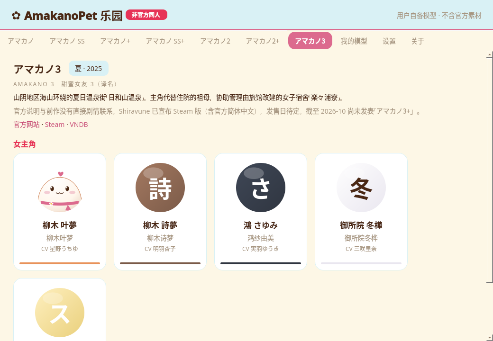
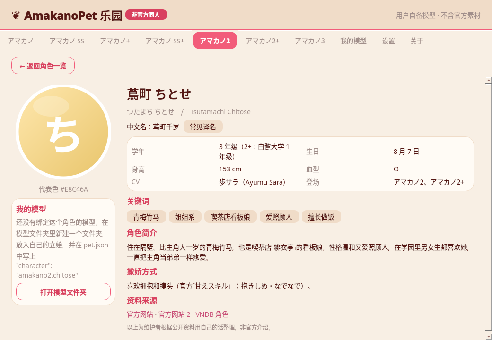
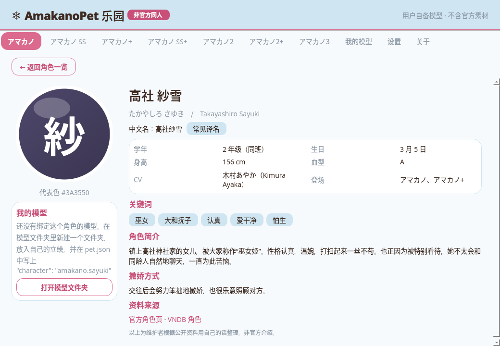
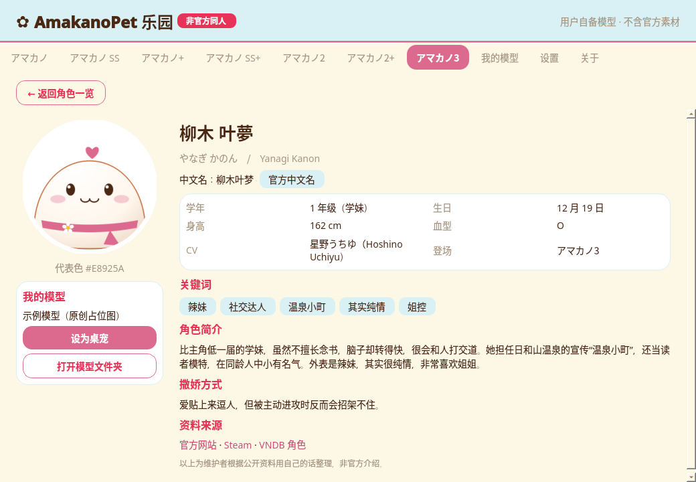
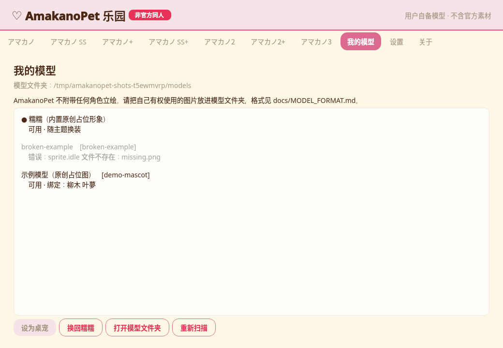
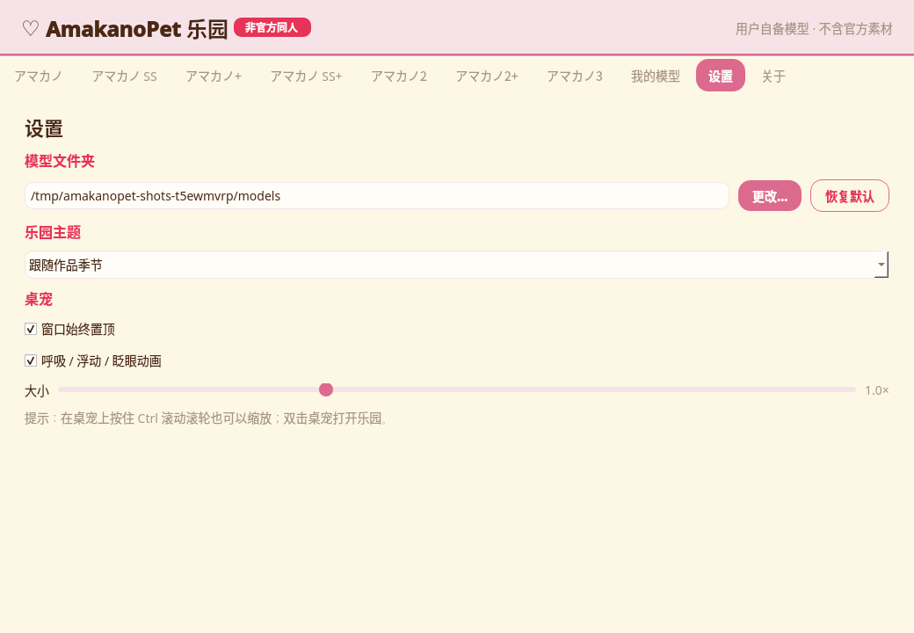
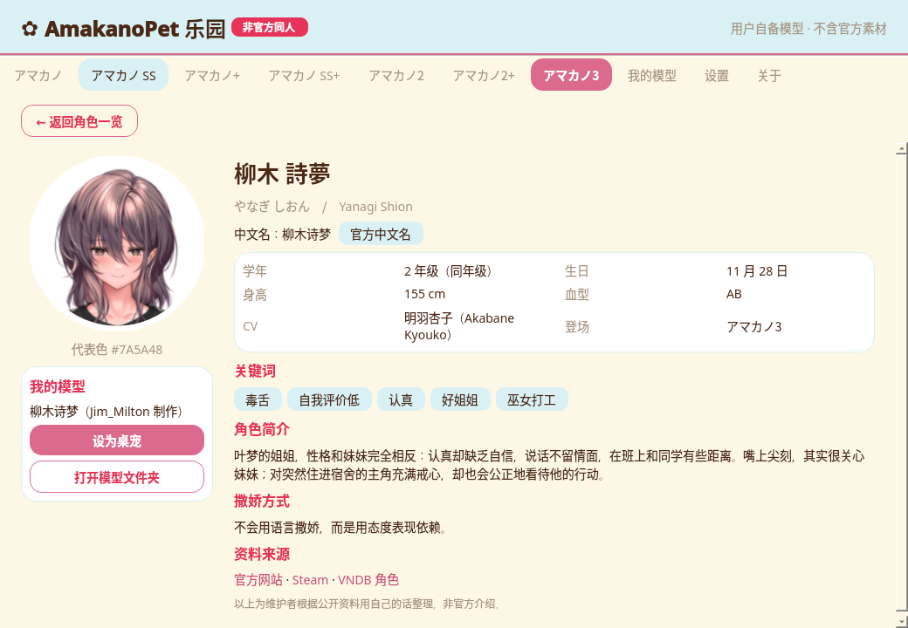
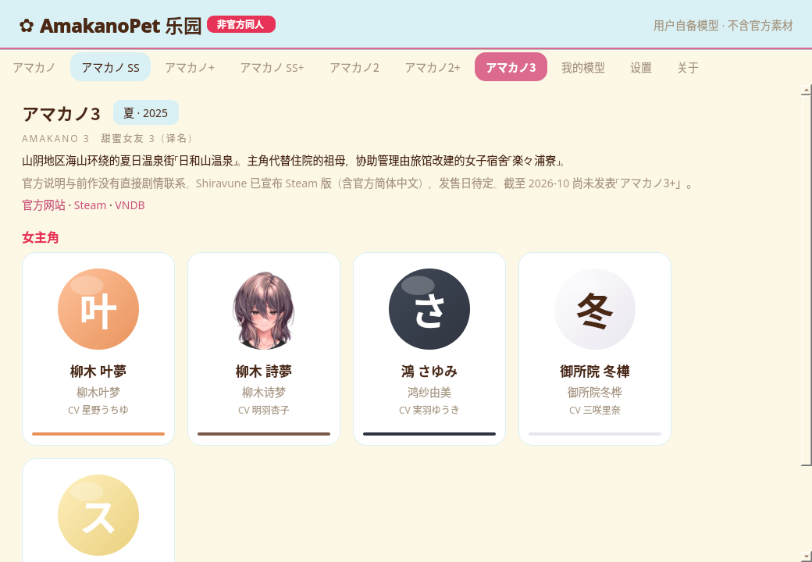
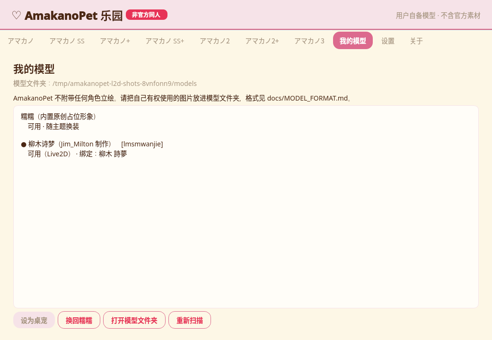

<div align="center">

# AmakanoPet 乐园

**アマカノ（甜蜜女友）系列的非官方同人桌宠 · 角色乐园**

[](https://github.com/Fiesty-Abyss/AmakanoPet/actions/workflows/ci.yml)


</div>

> [!IMPORTANT]
> **这是粉丝自制的非官方作品**，与あざらしそふと（Azarashi Soft）及其关联公司无关，也未获得其认可。
> 仓库中**不包含、也不会下载**任何官方立绘、Logo、语音或游戏解包资源；桌宠形象需要你**自备**。
> 详见 [DISCLAIMER.md](DISCLAIMER.md)。

<p align="center">
  
</p>

## ✨ 功能

| | |
|---|---|
| 🍡 **桌宠** | 透明无边框、始终置顶，可拖动、`Ctrl + 滚轮` 缩放；呼吸、上下浮动、随机眨眼，单击会轻轻跳一下 |
| 🎨 **原创占位形象「糯糯」** | 没有模型时显示的原创团子，完全由代码绘制，围巾与小饰物随季节主题变化 |
| 📁 **自备模型** | 把自己的立绘放进模型文件夹即可使用，支持闭眼帧、头像、缩放，并可绑定到乐园中的角色 |
| 🎭 **Live2D（可选）** | 安装 live2d-py 后可以显示自备的 Cubism 2 / 3+ 模型：动作、眨眼、物理与轻微的呼吸摆动，单击播放动作或表情，头部和眼睛柔和地跟随鼠标 |
| 🏞️ **乐园** | 作品页签 → 女主角卡片 → 角色资料页：读音、译名、学年、生日、身高、血型、CV、关键词、简介、撒娇方式与来源链接 |
| ❄️🍁🌻 **季节主题** | 每部作品按舞台季节自动换色：冬・雪国温泉街 / 秋・古都茶屋街 / 夏・海与温泉 |
| 🧭 **托盘与设置** | 托盘菜单切换桌宠、打开乐园、重新扫描；位置、大小、置顶、动画、主题等设置自动保存 |

收录作品：アマカノ / アマカノ SS / アマカノ+ / アマカノ SS+ / アマカノ2 / アマカノ2+ / アマカノ3，共 16 位女主角。
资料为维护者根据官方网站、VNDB、Steam 等公开信息**用自己的话**整理，仅包含全年龄内容。

## 📸 截图

> 以下均为程序在 Linux 上实际运行时截取的画面（离屏渲染），画面中只有原创占位图，没有任何官方美术素材。
> 使用社区 Live2D 模型的截图见下方 [社区模型](#-社区模型)。

| 角色资料（秋主题） | 角色资料（冬主题） |
|---|---|
|  |  |

| 绑定了自备模型的角色 | 我的模型 |
|---|---|
|  |  |

| 桌宠「糯糯」 | 设置 |
|---|---|
|  |  |

## 🚀 快速开始

```bash
git clone https://github.com/Fiesty-Abyss/AmakanoPet.git
cd AmakanoPet
python -m venv .venv
# Windows: .venv\Scripts\activate    macOS / Linux: source .venv/bin/activate
pip install -r requirements.txt
python main.py           # 启动桌宠
python main.py --park    # 启动并打开乐园

# 可选：Live2D 支持（Python 3.11+）
pip install -r requirements-live2d.txt
```

需要 Python 3.10+。首次启动后，右键桌宠或托盘图标即可打开菜单；**双击桌宠打开乐园**。

| 操作 | 说明 |
|---|---|
| 左键拖动 | 移动桌宠 |
| 单击 | 跳一下 |
| 双击 | 打开乐园 |
| `Ctrl` + 滚轮 | 缩放（0.5× – 2.0×） |
| 右键 | 菜单：打开乐园、切换桌宠、重新扫描、隐藏、退出 |
| `Esc` | 隐藏到托盘 |

## 🧸 使用自己的模型

1. 在乐园「我的模型」页点击 **打开模型文件夹**（默认位置见下表）。
2. 新建一个文件夹，放入 `idle.png`（透明背景的立绘），可选 `blink.png`（闭眼帧）和 `avatar.png`（头像）。
3. 可选：写一个 `pet.json`，填上名字并通过 `character` 绑定到角色：

```json
{
  "format": 1,
  "name": "我的叶梦",
  "character": "amakano3.kanon",
  "renderer": "sprite",
  "sprite": { "idle": "idle.png", "blink": ["blink.png"] },
  "avatar": "avatar.png",
  "scale": 1.0
}
```

4. 点击 **重新扫描**，在「我的模型」或托盘「切换桌宠」中选择它。

| 系统 | 默认模型文件夹 |
|---|---|
| Windows | `%APPDATA%\AmakanoPet\models` |
| macOS | `~/Library/Application Support/AmakanoPet/models` |
| Linux | `~/.local/share/AmakanoPet/models` |

**Live2D 模型**：安装 `requirements-live2d.txt` 后，把导出的模型文件夹（含 `*.model3.json`）整个放进模型文件夹即可，可选的 `pet.json` 写 `"renderer": "live2d"`。

完整格式、角色 id 列表与校验规则见 [docs/MODEL_FORMAT.md](docs/MODEL_FORMAT.md)。
想先试试格式？运行 `python tools/make_demo_model.py <模型文件夹>` 会生成一个由「糯糯」渲染的示例模型。

> 请只使用你**有权使用**的图片（自己画的、获得授权的、或许可证允许的素材），不要上传或分发他人的素材，也不要使用游戏解包文件。

## 🌸 社区模型

下面是社区作者制作的模型，**不包含在本仓库中**，也不由 AmakanoPet 分发。请从作者处获取，并遵守作者的使用条款。

| 角色 | 类型 | 作者 | 获取方式 |
|---|---|---|---|
| 柳木 詩夢（アマカノ3） | Live2D（Cubism 5），带头发物理、两个表情 | B 站 UP 主 **Jim_Milton** | 请到作者的 [B 站空间](https://b23.tv/55TJPMS) 按作者说明获取 |

**作者条款**（以作者空间的最新说明为准）：
- 允许免费分享，**禁止商用**。
- 模型的权利归作者及原作权利人所有。

**效果**：以下截图来自 AmakanoPet 实际运行画面（Xvfb + OpenGL）。模型由 B 站 UP 主 [Jim_Milton](https://b23.tv/55TJPMS) 制作，截图仅用于展示兼容效果，模型文件本身**不在**仓库中。

| 桌宠（Live2D） | 单击后（随机表情） | 资料页（自动生成头像） |
|---|---|---|
|  |  |  |

| 角色一览 | 我的模型 |
|---|---|
|  |  |

**使用方法**：
1. 从作者处获取模型。
2. 安装 Live2D 支持：`pip install -r requirements-live2d.txt`。
3. 把模型文件夹（含 `*.model3.json`）整个放进本地模型文件夹。可选：在 `pet.json` 中写 `"renderer": "live2d"`、`"character": "amakano3.shion"`，把它绑定到乐园里的诗梦。
4. 在「我的模型」中点击 **重新扫描** 并选用。格式详见 [docs/MODEL_FORMAT.md](docs/MODEL_FORMAT.md#live2d-模型v02-起)。

这个模型没有定义 `EyeBlink` 参数组，也没有动作文件（为 VTube Studio 面捕制作的模型很常见）。AmakanoPet 会自动处理：
- 由程序驱动眨眼；
- 单击时随机切换模型自带的表情：按表情文件的 Add / Multiply / Overwrite 混合方式渐入，2.5 秒后渐出（0.2.2 起）；
- 默认姿势与 Cubism Viewer 一致，视线跟随鼠标时头部最多转动约 12°，不再歪头（0.2.2 起）；
- 截取头部作为乐园卡片的头像。

> 请不要把社区模型提交到本仓库，也不要转载到网盘等渠道再分发。想推荐其他作者的模型？欢迎在 Issue 中附上**作者主页**链接（请不要附网盘链接）。

> 💡 **作者正在学习 Live2D 建模，后续会持续开发原创模型与更多功能。** 欢迎关注本仓库的更新。

## 🎮 支持正版

AmakanoPet 只是粉丝自制的小工具。喜欢这些角色的话，请购买正版游戏，支持あざらしそふと（海豹社）。

> ⚠️ 本系列原作为日本 **18 禁（成人向）** 美少女游戏，未成年人请勿购买。下面优先列出官方网站和官方指定的销售渠道；日本的成人向商店（FANZA GAMES、Getchu.com）需要先确认年龄，部分地区访问 FANZA 需要登录。Steam 版《甜蜜女友 3》由 Shiravune 发行，商店页未标注成人内容（以商店页最终信息为准）。

- 品牌官网：[あざらしそふと オフィシャルサイト](https://azarashi-soft.nexton-net.jp/top.html) · [全部作品一览](https://azarashi-soft.nexton-net.jp/product/)

| 作品 | 官方作品页 | 下载版（官方作品一览指向的渠道） | 实体版 / 其他 |
|---|---|---|---|
| アマカノ | [官网](https://azarashi-soft.nexton-net.jp/amakano/) · [Perfect Edition](https://azarashi-soft.nexton-net.jp/amakano-pe/) | [FANZA GAMES](https://dlsoft.dmm.co.jp/detail/next_0190/) | [アマカノ コンプリートボックス（官网）](https://azarashi-soft.nexton-net.jp/completebox/) · [Getchu](https://www.getchu.com/item/1292050/) |
| アマカノ ～Second Season～ | [官网](https://azarashi-soft.nexton-net.jp/amakano-ss/) | [FANZA GAMES](https://dlsoft.dmm.co.jp/detail/next_0217/) | 同上（コンプリートボックス） |
| アマカノ＋ | [官网](https://azarashi-soft.nexton-net.jp/amakano-plus/) | [FANZA GAMES](https://dlsoft.dmm.co.jp/detail/next_0223/) | 同上（コンプリートボックス） |
| アマカノ ～Second Season～＋ | [官网](https://azarashi-soft.nexton-net.jp/amakano-ss-plus/) | [FANZA GAMES](https://dlsoft.dmm.co.jp/detail/next_0249/) | [Getchu](https://www.getchu.com/item/970379/) |
| アマカノ2 | [官网](https://azarashi-soft.nexton-net.jp/amakano2/) · [Perfect Edition](https://azarashi-soft.nexton-net.jp/amakano2-pe/) | [FANZA GAMES](https://dlsoft.dmm.co.jp/detail/next_0287/) | [Getchu（Limited Edition）](https://www.getchu.com/item/1210314/) |
| アマカノ2＋ | [官网](https://azarashi-soft.nexton-net.jp/amakano2-plus/) | [FANZA GAMES](https://dlsoft.dmm.co.jp/detail/next_0370/) | [Getchu](https://www.getchu.com/item/1210315/) |
| アマカノ3 | [官网](https://azarashi-soft.nexton-net.jp/amakano3/) | [FANZA GAMES](https://dlsoft.dmm.co.jp/detail/next_0452/) | [Getchu](https://www.getchu.com/item/1334471/) · **[Steam《甜蜜女友 3》](https://store.steampowered.com/app/4932930/)**（简繁中文，发售日待公布，可加入愿望单） |

各作品的 Android 版通过 DMM GAMES 商店发售，详见各官方作品页。截至 2026-10-17，DLsite 上没有找到本系列游戏本体的官方销售页，所以没有列出。

## 🗂️ 项目结构

```text
main.py                 入口（--park 启动时打开乐园）
app/
  config.py             设置持久化（QSettings / INI）
  theme.py              季节主题与样式表
  catalog.py            作品与角色资料（只读）
  data/amakano.json     资料数据（纯文字 + 来源链接）
  models.py             模型文件夹扫描与 pet.json 校验
  renderers/            精灵渲染器、动画函数、原创吉祥物、可选 Live2D 后端
  ui/                   乐园窗口与通用组件
  window.py / tray.py   桌宠窗口与系统托盘
  controller.py         串联各模块
tools/                  示例模型生成、截图脚本、Live2D 测试样例下载
tests/                  pytest + pytest-qt
```

## 🛠️ 开发

```bash
pip install -r requirements-dev.txt
ruff check .
QT_QPA_PLATFORM=offscreen python -m pytest -q
QT_QPA_PLATFORM=offscreen python tools/capture_screenshots.py docs/screenshots   # 重新截图
```

CI 在 Python 3.10 / 3.12 / 3.13 上运行 ruff 与离屏测试；另有一项 Live2D 任务在 Xvfb 中渲染 Live2D 官方免费示例模型。示例模型只在测试时下载，不会进入仓库：

```bash
pip install -r requirements-live2d.txt
export AMAKANOPET_LIVE2D_SAMPLE="$(tools/fetch_live2d_sample.sh Mark | tail -1)"
QT_QPA_PLATFORM=xcb xvfb-run -a python -m pytest -q tests/test_live2d.py
```

## 🗺️ 路线图

- [x] v0.1：精灵渲染器、自备模型、乐园、季节主题、托盘与设置
- [x] v0.2：Live2D（Cubism）模型支持（仅限用户自备的模型）
- [ ] 互动小动作、多显示器与贴边、更多设置项

资料有误或需要补充？欢迎在 [Issues](https://github.com/Fiesty-Abyss/AmakanoPet/issues) 中附上来源链接告诉我们。

## 📄 许可证

代码以 [MIT License](LICENSE) 发布。作品名、角色名等相关权利归あざらしそふと及各权利方所有，MIT 许可证不涵盖这些权利。
